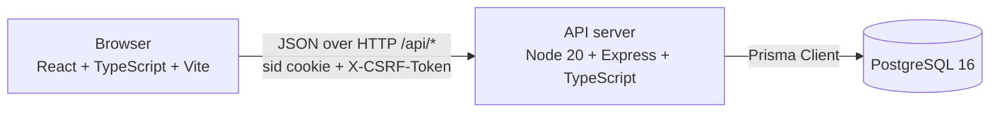
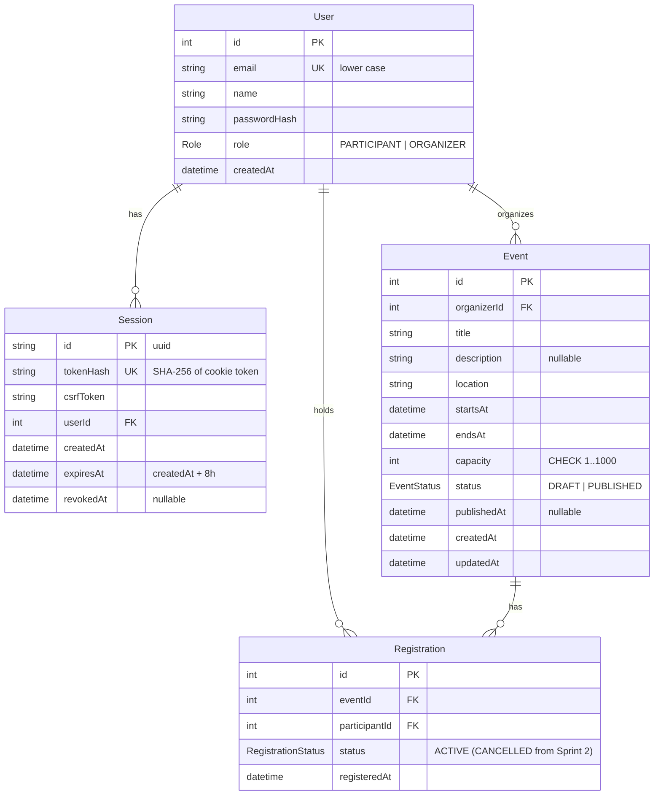

# System Level Software Design Specification (SDS)

## 1. Architecture and stack



| Component | Technology | Responsibility |
|---|---|---|
| Client (`client/`) | React 18, TypeScript, Vite, React Router | Screens, forms, client side validation for quick feedback, role aware navigation. Holds no authority. |
| API (`server/`) | Node 20, Express, TypeScript, zod, bcrypt, cookie-parser | Sessions, CSRF, role and ownership checks, validation, business rules, transactions, safe errors. |
| Database | PostgreSQL 16, Prisma ORM and Prisma Migrate | Durable storage; constraints as a final safety net. Dedicated database `event_planner`, separate from TokTickIT. |
| Tests | Vitest + Supertest (API on real PostgreSQL), Vitest + React Testing Library (UI), Playwright (E2E) | Verification of AC-01 to AC-19. |

Business rules are enforced in the API service layer (`server/src/services/`), inside database transactions where concurrency matters. The database repeats key rules as constraints. The client repeats simple validation only for user experience.

```
routes (zod parsing) -> middleware (requireSession, requireCsrf, requireRole) -> services (rules, ownership, transactions) -> Prisma
```

In development Vite proxies `/api` to the API so the cookie is same origin. In production (Lab 5) one container serves the API and the built client from one origin.

## 2. Data model



Constraints and ownership:
1. `User.email` unique.
2. `Session.tokenHash` unique; the raw token exists only in the cookie.
3. `Event.organizerId` is the ownership link for publish and roster (BR-05).
4. `Event.capacity` CHECK `capacity BETWEEN 1 AND 1000` and `endsAt > startsAt` CHECK, added as raw SQL in the migration.
5. Partial unique index `registration_one_active` on `Registration(eventId, participantId) WHERE status = 'ACTIVE'` (BR-03, DEC-02).
6. `Registration.participantId` is the ownership link for personal registrations.
7. Indexes: `Event(status, startsAt)`, `Registration(eventId, status)`, `Session(userId)`.

Later sprints add columns through new migrations (for example `registrationDeadline`, `cancelledAt`, `checkedInAt`, status `CANCELLED`).

Database setup, migrations and seed:
1. `npx prisma migrate deploy` (or `migrate dev` locally) applies versioned migrations in `server/prisma/migrations/`.
2. `npm run seed` creates synthetic users: `organizer1@example.test`, `organizer2@example.test`, `participant1@example.test`, `participant2@example.test`, `participant3@example.test`, with password from `SEED_PASSWORD`, plus one draft and one published event owned by organizer1. The seed uses upsert by email with an empty update, so re running it never duplicates rows or overwrites a changed password.
3. The server never migrates, truncates or seeds on startup (NFR-03).
4. Tests use a separate database from `server/.env.test`, reset by the test setup, never the development database.

## 3. UI conventions

| Route | Role | Purpose |
|---|---|---|
| `/login` | public | Login form |
| `/events` | any | Published upcoming events with remaining places |
| `/events/:id` | any | Event detail; Register button for Participants |
| `/registrations` | Participant | My registrations |
| `/registrations/:id` | Participant | Saved registration detail (receipt) |
| `/organizer/events` | Organizer | My events (draft and published) |
| `/organizer/events/new` | Organizer | Create event form |
| `/organizer/events/:id` | Organizer | Own event detail, Publish, roster |

Shared behaviour:
1. AppShell header: app name, user name and role, role based links, Logout.
2. No session: redirect to `/login`. Wrong role route: "You do not have access to this page". After login: Participants go to `/events`, Organizers to `/organizer/events`. Convenience only; the API enforces access.
3. Every input has a visible label; validation messages appear under the field and are linked with `aria-describedby`; focus moves to the first invalid field on submit.
4. Pending: submit buttons show a busy label and are disabled (prevents double submit). Lists show "Loading...".
5. Empty states: "No upcoming events", "You have not registered for any events", "You have not created any events yet", "No registrations yet".
6. Errors: API message in an alert at the top of the form or page; network failure shows "Could not reach the server. Try again." Raw server details are never shown.
7. Layout works at 1440x900 and 390x844 without horizontal overflow; tables become stacked cards below 640 px.
8. Times shown in Asia/Bangkok, for example `Mon 10 Nov 2026, 14:00`.

## 4. API conventions

1. Base path `/api`, JSON bodies, plural nouns; state transitions as action sub resources (`POST /api/events/:id/publish`); `mine` collections for the current user.
2. The acting user always comes from the session. Requests never carry `organizerId`, `participantId`, `userId` or `role`; such fields are ignored.
3. zod validates bodies and path ids; unknown fields are ignored.
4. Success: 200 read or action, 201 create. Lists return `{ "items": [...] }`.
5. Errors always use:

```json
{ "error": { "code": "EVENT_FULL", "message": "This event has no places left.", "details": [] } }
```

| Status | Codes |
|---|---|
| 400 | `VALIDATION_ERROR` (`details: [{ field, message }]`) |
| 401 | `UNAUTHENTICATED`, `INVALID_CREDENTIALS` |
| 403 | `FORBIDDEN` (role not allowed), `CSRF_INVALID` |
| 404 | `NOT_FOUND` (missing, or not visible to this user; DEC-10) |
| 409 | `ALREADY_REGISTERED`, `EVENT_FULL`, `REGISTRATION_CLOSED`, `INVALID_STATE` |
| 500 | `INTERNAL_ERROR` (generic message; details only in server log) |

Sprint 1 endpoints (details in [api-spec.md](sprints/sprint-1/api-spec.md)):

| Method and path | Who | Feature |
|---|---|---|
| `POST /api/auth/login` | public | F-01 |
| `GET /api/auth/me` | any session | F-01 |
| `POST /api/auth/logout` | any session | F-01 |
| `POST /api/events` | Organizer | F-02 |
| `POST /api/events/:id/publish` | owning Organizer | F-02 |
| `GET /api/events` | any session | F-02 |
| `GET /api/events/mine` | Organizer | F-02 |
| `GET /api/events/:id` | any session (drafts: owner only) | F-02 |
| `POST /api/events/:id/registrations` | Participant | F-03 |
| `GET /api/registrations/mine` | Participant | F-03 |
| `GET /api/registrations/:id` | holding Participant | F-03 |
| `GET /api/events/:id/registrations` | owning Organizer | F-04 |

## 5. Role and permission matrix

| Operation | Anonymous | Participant | Organizer (owner) | Organizer (not owner) |
|---|---|---|---|---|
| Log in | yes | yes | yes | yes |
| Current identity, log out | 401 | yes | yes | yes |
| Create event | 401 | 403 | yes (becomes owner) | yes (becomes owner) |
| Publish event | 401 | 403 | yes, DRAFT only (else 409) | 404 |
| List my events | 401 | 403 | own only | own only |
| List / view published events | 401 | yes | yes | yes |
| View a draft | 401 | 404 | yes | 404 |
| Register | 401 | yes (BR-02 to BR-04) | 403 | 403 |
| List my registrations | 401 | own only | 403 | 403 |
| View a registration | 401 | own only, else 404 | 403 | 403 |
| View event roster | 401 | 403 | yes | 404 |

Sprint 2 and 3 operations (cancel registration, edit or cancel event, check in, reports) follow the same pattern: Participants act only on their own registrations; only the owning Organizer acts on an event.

Enforcement: `requireSession` (401), `requireRole` (403), `requireCsrf` on POST, PUT, PATCH and DELETE except login (403 `CSRF_INVALID`), ownership checks in services (404). Hidden UI controls are never relied on.

## 6. Authentication, sessions and CSRF

1. Passwords: bcrypt, cost 12. Responses use explicit Prisma `select` lists that exclude `passwordHash` and session fields.
2. Login: email trimmed and lower cased; `bcrypt.compare`; unknown email runs a dummy compare. Unknown email and wrong password both return 401 `INVALID_CREDENTIALS` "Email or password is incorrect." Empty or malformed fields return 400.
3. Session creation: 32 random bytes (base64url) as the token; a `Session` row stores its SHA-256 hash, a random `csrfToken`, and `expiresAt = now + 8h` (absolute, not extended by activity).
4. Cookie `sid`: `HttpOnly; SameSite=Lax; Path=/; Max-Age=28800`, plus `Secure` when `NODE_ENV=production`.
5. `requireSession` hashes the cookie token, loads the session and user, and rejects with 401 if missing, revoked or expired. It sets `req.user = { id, name, email, role }` and `req.session`.
6. CSRF: login and `GET /api/auth/me` return `csrfToken`; the client keeps it in memory and sends `X-CSRF-Token` on every state changing request. A missing or wrong token returns 403 `CSRF_INVALID` and changes nothing. Together with SameSite=Lax this blocks cross site form posts.
7. Logout sets `revokedAt = now`, clears the cookie, and the client clears AuthContext and cached data. Replaying the old cookie returns 401.
8. The client never stores tokens in localStorage.

## 7. Configuration and delivery design

Environment variables (`server/.env`; committed example `server/.env.example` with placeholders; real files in `.gitignore`):

| Variable | Purpose |
|---|---|
| `DATABASE_URL` | PostgreSQL connection for the dedicated `event_planner` database |
| `SESSION_TTL_HOURS` | Absolute session lifetime, default 8 |
| `PORT` | API port, default 3000 |
| `NODE_ENV` | `development`, `test` or `production` |
| `SEED_PASSWORD` | Password for synthetic seed accounts (local only) |

Test configuration lives in `server/.env.test` (also ignored; example committed). The client bundle contains no secrets.

Local database: `docker compose up -d db` starts PostgreSQL 16 with a named volume, so data survives restarts.

Planned GCP deployment (Lab 5):
1. Multi stage Dockerfile builds the client and server and runs one Node process serving `/api` and the static client.
2. Cloud Run (or a Compute Engine VM with Docker, as in earlier labs) runs the container.
3. Cloud SQL for PostgreSQL provides durable storage; `prisma migrate deploy` runs as a release step, never on every start.
4. `DATABASE_URL` and `SEED_PASSWORD` come from Secret Manager.
5. GitHub Actions runs build and tests on every PR and deploys reviewed releases from `main`.

## Version history

| Version | Date | Change |
|---|---|---|
| 1.0 | 2026-11-03 | Initial system SDS aligned with Issues #1 to #8 |
